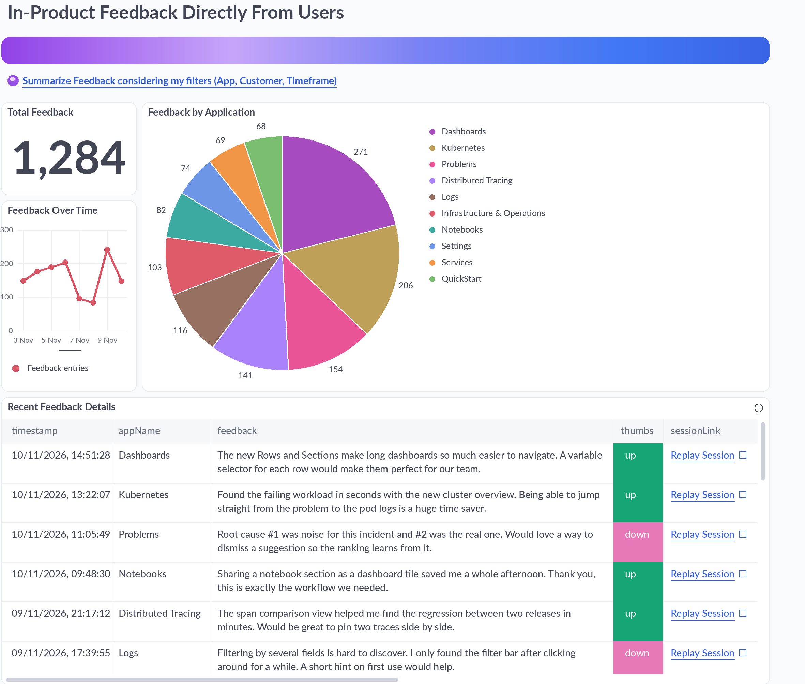

# In-Product Feedback with Session Replay

> Collect user feedback inside your own web app, store it as business events in Grail, and link every entry to the Session Replay of the user's journey. No third-party feedback tool needed, and no screenshots or videos to attach.

## What it does

Product teams often get feedback without the story behind it. This solution adds a lightweight feedback widget to any web app monitored with Dynatrace RUM. Every submission (free text, 👍/👎, or both) is sent as a `feedback-form-submit` business event. RUM enriches it with session, device, browser, OS and geo context automatically.

A dashboard turns the events into a triage view, with a **Replay** link on every row, so product managers can watch what the user did *before* they gave feedback. One workflow posts each entry to Slack in real time. A second one sends a weekly AI digest.

This is the pattern Dynatrace uses internally for its own apps, adapted for your environment.

## Screenshots



## Prerequisites

- Dynatrace SaaS (latest Dynatrace) with Grail.
- A web application monitored with **RUM JavaScript**. Business events are captured for monitored sessions only.
- **Session Replay** enabled for that application, if you want replay links. Configure masking for sensitive fields.
- Permissions to read business events (`storage:bizevents:read`), create dashboards, and create workflows.
- Optional: a Slack connection for the **Slack for Workflows** app, for the two workflows.
- Optional: Dynatrace Intelligence generative AI enabled, for the weekly digest. The "Summarize with Dynatrace Assist" link also needs agentic AI mode, so that Assist can run the DQL query. The prompt deliberately doesn't query personal data, because Assist blocks requests that contain PII.

## Setup

1. **Add the widget to your web app.** Copy `feedback-widget.js` into your app, or bundle it, and initialize it:
   ```html
   <script src="/js/feedback-widget.js"></script>
   <script>
     DtFeedback.init({ appName: 'My Web Shop', appVersion: '2.14.0' }); // adds a floating "Feedback" button
   </script>
   ```
   Optional placements:
   ```js
   // Right after a user completes a journey (highest response rate):
   DtFeedback.open({ featureName: 'Checkout' });

   // Inline thumbs next to a result users judge (highest participation):
   DtFeedback.thumbs(document.querySelector('#search-results-footer'), { featureName: 'Search' });
   ```
   Already have your own form? Skip the widget and send the event yourself:
   ```js
   dynatrace.sendBizEvent('feedback-form-submit', {
     'event.name': 'Feedback submitted',
     appName: 'My Web Shop', appVersion: '2.14.0',
     feedbackType: 'checkout', // stable feature name, lowercase-with-dashes
     feedback: 'Free text from the user', // omit when empty
     thumbs: 'down',                       // 'up' | 'down', omit when not used
   });
   ```
2. **Import the dashboard.** Open **Dashboards**, select **Upload**, and choose `dashboard.json`.
3. **Import the workflows (optional).** Open **Workflows**, select **Upload**, and choose `workflow-slack-notification.json` and/or `workflow-weekly-digest.json`.
4. **Configure the workflows.** In each Slack task, select your Slack connection and replace `<YOUR_SLACK_CHANNEL_ID>` with your channel ID. Then save the workflow and keep it enabled.
5. **Test it.** Submit a feedback entry in your app, check the event in a notebook (`fetch bizevents | filter event.type == "feedback-form-submit"`), then open the dashboard.

## Configuration

| What | Where | Default |
|---|---|---|
| App name and version | `DtFeedback.init({ appName, appVersion })` | `document.title` |
| Feature tag | `featureName` in `open()` / `thumbs()` → `feedbackType` field | `general` |
| Widget texts, color, launcher position | `DtFeedback.init({...})` options at the top of `feedback-widget.js` | Dynatrace purple, bottom-right |
| Extra, non-personal context (e.g. plan) | `extraFields: () => ({ plan: 'pro' })` | none |
| Dashboard timeframe | Dashboard settings | Last 30 days |
| Slack channel and connection | Slack tasks in both workflows | must be set |
| Digest schedule | Weekly digest trigger | Mondays 08:00 UTC |

**Choose `featureName` values deliberately.** Use the names users see in the UI, keep to five to ten per app, and don't rename them between releases. Renaming splits your history in two.

**Add business context (optional).** If you maintain account data in a Grail lookup table, join it in the "Recent feedback" tile. This lets you weigh feedback by customer impact:
```
| lookup [ load "/lookups/accounts" ], sourceField: accountId, lookupField: accountId, fields: { tier }
```
Send the matching key (for example `accountId`) through `extraFields`.

## Notes & limitations

- **Blocked RUM:** ad blockers and strict privacy modes can block the RUM JavaScript. The widget then disables **Submit** and shows a tooltip, instead of failing silently.
- **Privacy:** the text area is marked for masking in Session Replay, so the text is captured once, in the event. The widget sends only the page path, never query strings. Review what you send in `extraFields`, and tell users how feedback is used (the default notice text does this).
- **Replay links** point to the session viewer of your environment. They work for sessions that were recorded with Session Replay and are still within your retention period.
- **Volume:** expect tens of written comments per month for a busy app. Thumbs reach far more users because they take one click.
- **Field names:** RUM enrichment fields (`device.type`, `os.name`, `browser.name`, `geo.country.name`, `dt.rum.session.id`) are used as in current Dynatrace. Check a sample event if your setup differs.
- The weekly digest uses the generative AI workflow action. If it's not available in your environment, remove the `summarize` task and post the raw list instead.
