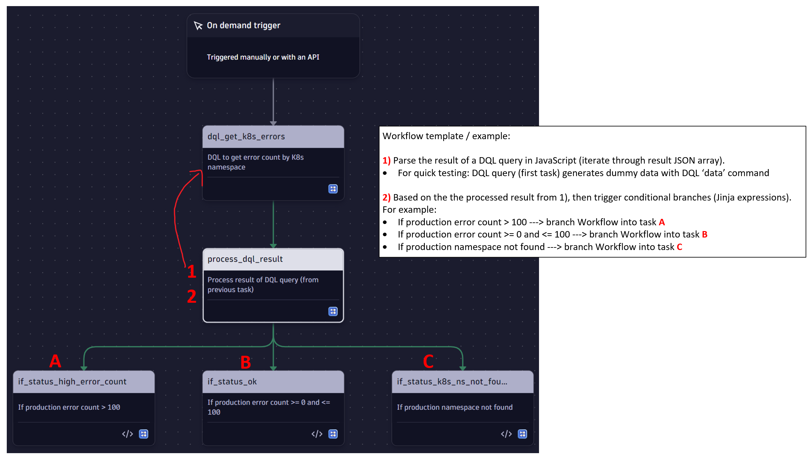
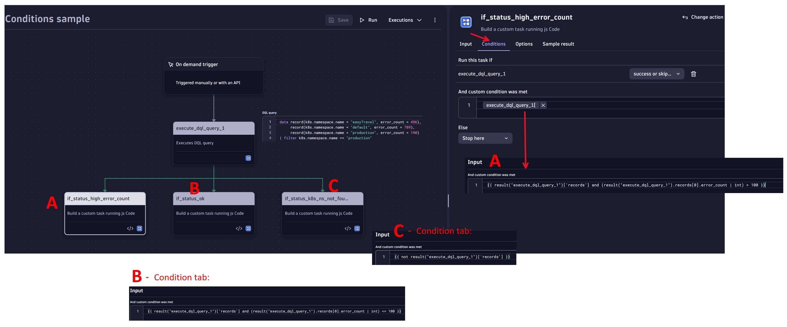

# DQL Result Conditional Branches

Learn how to branch a workflow on the result of a DQL query, with and without a JavaScript step.

## What it does

Both workflows run a DQL query, which uses the `data` command to generate test data with error counts per Kubernetes namespace, and then continue into one of three branches:

- **A:** production error count > 100
- **B:** production error count between 0 and 100
- **C:** production namespace not found

**Parse DQL with JavaScript** (`parse-dql-with-javascript.*`) iterates over the DQL result array in a JavaScript task and branches on the processed result with Jinja conditions. Use it when you need custom logic before deciding. **Conditions only** (`conditions-only.*`) is the shorter version: it evaluates the DQL result directly in each branch's condition, with no JavaScript task.

## Screenshots

## Prerequisites

- Dynatrace SaaS with Workflows
- No connections or external apps. The DQL query generates its own test data.

## Setup

1. Download one of the workflows. Each comes in two formats:
   - `*.workflow-template.yaml`: workflow template. Import it in **Workflows** with **Upload**.
   - `*.workflow.json`: JSON export for the [Automation API](../workflow-import-export-api/).
2. Import it and choose **Run**. The workflow uses the on-demand trigger.
3. Open the execution to see which branch ran.

## Configuration

- Replace the `data` command in the first task with your real query, for example error counts from `fetch logs`.
- Adjust the thresholds in the branch conditions (`if_status_high_error_count`, `if_status_ok`, `if_status_k8s_ns_not_found`).

## Notes & limitations

- Migrated from the archived [Dynatrace-workflow-samples](https://github.com/Dynatrace/Dynatrace-workflow-samples) repository.

## Related solutions

- [Workflow JavaScript Snippets](../workflow-javascript-snippets/)
