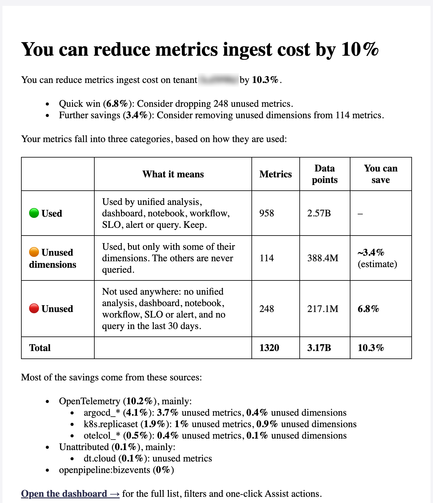
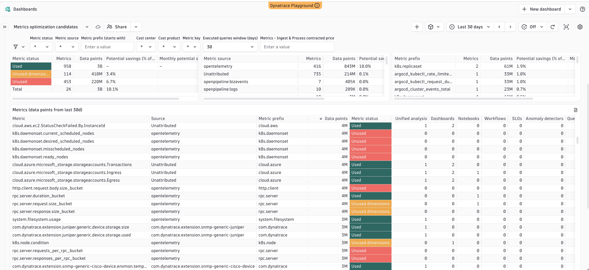

# Optimize metrics ingest cost

> Find the billable metrics and dimensions that nothing uses, and see what dropping them would save, in a dashboard and an emailed report.

## What it does

The Optimize metrics ingest cost workflow finds the billable metrics, and the dimensions of metrics, that you pay for but that nothing in your environment uses. It estimates what dropping them would save, shown as a share of your metric data points, and gives you a dashboard and an emailed report with the candidates.

The workflow reads your tenant and reports. It does not change your metric ingest settings. To act on a candidate, you use the links in the dashboard, which open a Dynatrace Assist prompt that guides you through the change.

> Questions or issues with this example? Open a [GitHub issue](https://github.com/Dynatrace/community-examples/issues) or ask in **#help-community-examples** on Slack.

## Screenshots





## How it works

1. **Select.** The workflow ranks your billable metrics by data points of the last 30 days and analyses the largest ones (10,000 by default). On large tenants these metrics carry almost all of the cost. The report states what share of all data points the analysed metrics hold.
2. **Find use.** It reads where each metric is used:
   - dashboards, notebooks, and workflows of all users
   - SLOs and anomaly detectors
   - the screens and topology of installed extensions, and the essential metrics of the cloud integrations that Dynatrace apps show
   - DQL queries executed in the last 30 days (optionally 60 or 90)
3. **Classify.** Each metric is *Used*, *Used with unused dimensions*, or *Unused*.
4. **Estimate.** For unused metrics and unused dimensions, it estimates the saving in series and in data points from the last 30 days.
5. **Report.** It creates or updates the dashboard **Metrics optimization candidates** and emails a summary written by Dynatrace Intelligence.

The workflow reads every dashboard, notebook, workflow, SLO and anomaly detector, or stops with an error. If part of the reading fails (a very large notebook can run a step out of memory), that part is read again in smaller pieces. A notebook that cannot be read even on its own is skipped, and the report names it in an italic note, so that you can check it before you drop a metric that only it may use.

## Prerequisites

- A Dynatrace SaaS tenant with these apps:
  - **Workflows**: runs the workflow and sends the emails.
  - **Dashboards**: shows the results.
  - **Dynatrace Assist**: writes the summary and opens the prompts behind the guidance links.
- The workflow file `optimize-metrics-ingest-cost.workflow-template.yaml` in this folder.
- A user who can run the workflow and who has the permissions listed in step 2 of [Setup](#setup). Some of them read other users' dashboards, notebooks, and workflows, so they need administrator-level access.

## Setup

To set up the workflow

1. Go to **Workflows**, select **Upload**, and choose the file `optimize-metrics-ingest-cost.workflow-template.yaml`.
2. Allow the permissions the workflow needs. In the Workflows app, go to **Settings** > **Authorization settings** and enable the permissions below. The workflow can only use what the user who runs it has, so that user needs them too.

   | Purpose | Permissions |
   |---|---|
   | Read dashboards, notebooks, and workflows of all users | `document:documents:read`, `document:documents:admin`, `automation:workflows:read`, `automation:workflows:admin` |
   | Read SLOs and anomaly detectors | `slo:slos:read`, `environment-api:slo:read`, `settings:objects:read` |
   | Read installed extensions | `environment-api:extensions:read` |
   | Run the queries | `storage:metrics:read`, `storage:system:read`, `storage:buckets:read` |
   | Write the usage metrics and the dashboard | `storage:metrics:write` (or `openpipeline:metrics:ingest`), `document:documents:write` |
   | Send the report and failure messages | `email:emails:send` |
   | Write the AI summary | `davis-copilot:conversations:execute` |
   | Run the workflow | `app-engine:functions:run`, `automation:workflows:run` |

3. Select **Workflow input** and scroll down to the **Workflow input and result** and **Default input** sections.
4. Update the `emails.to` parameter to an array of strings with the addresses that should get the report. For example:

   ```json
   "to": [ "me@example.com", "you@example.com" ]
   ```

   The same addresses get the message that says why a run produced no report.
5. Optional: change the other inputs. See [Configuration](#configuration).
6. Test the workflow with a manual run by selecting **Run**. The run time grows with the number of metrics: about 5 minutes for 1,000 billable metrics and about 15 minutes for 10,000. A run costs less than $1 if you run it and remove it on the same day.
7. When the run finishes, you receive the email. Open the dashboard that it links to.

### Run it regularly

The workflow has a manual trigger. To run it on a schedule, select **Change trigger** and choose a schedule, for example monthly, at an off-peak time.

## Configuration

The workflow runs without changes except `emails.to`. These inputs change its behavior:

| Input | Default | What it does |
|------------------|--------|------------------------------------------|
| `maxMetrics` | 10,000 | The number of metrics to analyse: the largest ones by data points. 10,000 is the default and the recommended maximum. Don't set a higher value. The workflow accepts 100 to 20,000, and replaces a value outside that range with the nearest limit. |
| `historyDays` | 30 | The number of days of executed queries that count as use of a metric: 30, 60, or 90. Any other value is replaced by 30. A longer window is more careful but makes the run longer. On a tenant with more than 5,000 metrics, we don't recommend going above 30, because a longer window can make the workflow fail. |

## Use the results

Every run gives you two things: an executive summary in your email, and the dashboard **Metrics optimization candidates** with the full list.

### Executive summary

When a run finishes, the addresses in `emails.to` receive an email with the result. It starts with the total you can save, as a share of all your metric data points:

The email contains:

- **The headline and two actions.** A *quick win*, which is dropping unused metrics, and *further savings*, which is removing unused dimensions from metrics that are otherwise used. Each has its share of data points.
- **The three categories.** *Used* (keep), *Unused dimensions* (the metric is used, but some dimensions never are), and *Unused* (nothing uses the metric). For each: the number of metrics, their data points, and what you can save. The saving for unused dimensions is an estimate.
- **Where the savings come from.** The sources and metric prefixes with the largest savings.
- **A link to the dashboard.**
- **Unused metrics, to drop first.** The 10 largest unused metrics and the share of data points that dropping them saves, with the Dynatrace Assist prompt to use for each one.
- **Unused dimensions, to go carefully.** Why caution is needed, how to proceed one metric at a time, and the metrics with the largest estimated saving. Dropping a dimension merges series, which can change averages and counts.
- **Notes at the end.** What the estimates are based on, any metrics that were too large to estimate (their saving is not included), and any notebooks that were skipped because they could not be read.

Savings are estimates from the last 30 days of data points. Check with the owners of the sources that nothing outside Dynatrace reads a metric before you drop it.

### Dashboard

The email links to the dashboard **Metrics optimization candidates**. The first run creates it, and later runs keep it and update it. Data points are from the last 30 days, and the timestamp tile shows the run whose data you see.

- **Summary tables** at the top show the metrics by status, by source, and by prefix, with the potential savings as a share of all data points.
- **Filters** narrow the list: **Metric status**, **Metric source**, **Metric prefix**, **Cost center**, **Cost product**, **Metric key**, and **Executed queries window**. Enter your contracted price in **Metrics - Ingest & Process contracted price** to see the savings in USD.
- **The Metrics table** has one row per metric: its source, data points, and status, where it is used (**Unified analysis**, the number of Dynatrace apps that show the metric, then **Dashboards**, **Notebooks**, **Workflows**, **SLOs**, **Anomaly detectors**, and **Query runs**), its unused dimensions, and its potential savings.
- **AI Optimization guidance** is the last column of the table. Its links ask Dynatrace Assist to drop an unused metric, drop unused dimensions, or analyse cardinality.

If **Unused dimensions (distinct values)** shows a message instead of dimensions, the dimensions could not be listed for that metric. This happens when the metric has too many series or dimensions to read, when it had no data in the last hour, or when the run did not reach it in its time budget (the metrics with the most series come first). For these rows, use **Analyze cardinality**.

Review each recommendation before you apply a change to your tenant. Dropping a metric or a dimension stops its ingest, and the data that was not ingested cannot be recovered.

## What the workflow writes to your tenant

- The dashboard **Metrics optimization candidates**.
- The custom metrics `custom.metrics_usage.*`, which the dashboard reads. A run writes about 11,000 data lines on a tenant with 1,000 billable metrics.
- The emails to the addresses in `emails.to`.

## Troubleshooting

| Situation | What happens |
|---|---|
| A permission is missing | The first task, `check_permissions`, stops the run with an error that lists the missing permissions, and sends an email with the same text. Nothing is analysed. It cannot test `email:emails:send` and `davis-copilot:conversations:execute`. |
| No email permission | No email can be sent. Look at the run in the Workflows app. |
| No AI permission, or the AI step fails | The report is still sent, with a template summary instead of the AI text. |
| A step fails | The run ends in Error, and an email names the failed stage and the reason. |
| Part of the reading of dashboards, notebooks or workflows fails | The failed part is read again in smaller pieces, and the report is still sent. A notebook that cannot be read even alone is skipped and named in an italic note at the end of the email. If more than 5 parts fail, the run stops with an email. |
| You need to find out why a run failed or came close to a limit | Open the run in the Workflows app and read the log of the failed step. `read_history` logs a range check before each part of the query history; `query_history` and `classify` log how near the run came to each limit (for example "different metric and dimension pairs 2%"). |
| The tenant is larger than one run can handle | The run stops before the long reading, and the error says which kind of artifact is over its limit, by how much, and what to do. |
| A dashboard or notebook cannot be parsed | It is read as plain text, so its metric keys still count as used. The report lists it by id and name. |

## Notes & limitations

- **Large tenants.** If your tenant has more billable metrics than `maxMetrics`, the workflow analyses the largest ones. The report and the dashboard say what share of your data points they cover.
- **Time windows.** Data points and savings are always from the last 30 days. `historyDays` changes only how many days of executed queries count as use of a metric.
- **Dimensions.** For some metrics the unused dimensions cannot be listed (see [Use the results](#use-the-results)). Use **Analyze cardinality** for them.
- **Estimates.** Savings are estimates for planning. Check each candidate before you drop it.
- **What counts as use.** The workflow counts the use that it can read in your tenant. A metric that something else relies on can still appear as a candidate, so review before you act.
- **One tenant.** The workflow reads only the tenant it runs on.

## Related solutions

- [Workflows documentation](https://docs.dynatrace.com/docs/shortlink/automation-overview)
