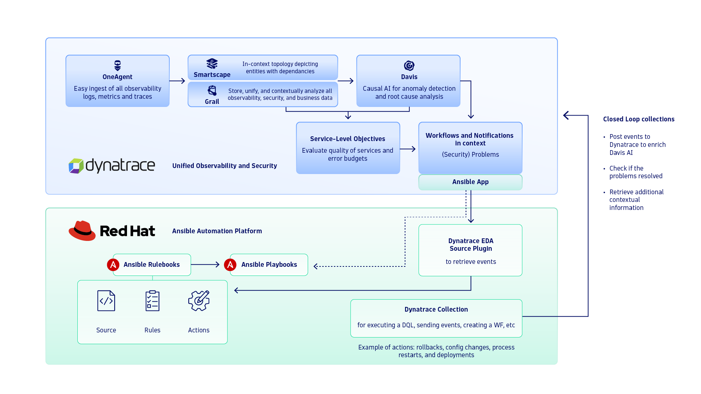
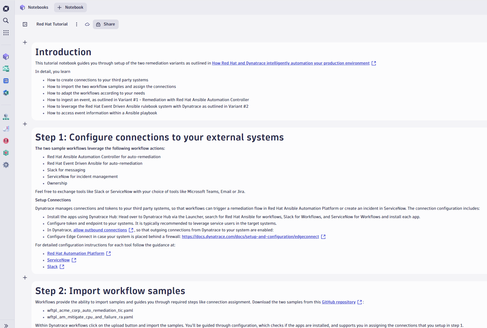

# Red Hat Ansible Auto-Remediation

Close the loop from Davis problem to fix: Dynatrace detects the problem, Red Hat Ansible remediates it, and the ticket documents what happened.

## What it does

The artifacts support the blog post [How Red Hat and Dynatrace intelligently automate your production environment](https://www.dynatrace.com/news/blog/how-red-hat-and-dynatrace-intelligently-automate-your-production-environment/), which describes two variants:

- **Variant 1: Ansible Automation Controller.** When Davis detects a problem, the workflow:
  - creates or updates a ServiceNow incident;
  - finds the remediation action with DQL;
  - launches an Ansible job template;
  - comments the result on the incident and the problem;
  - notifies the owning team in Slack.

  Two workflow files implement it: `auto-remediation-with-ticketing.workflow-template.yaml` and the shorter `core-journey-auto-remediation.workflow-template.yaml`.
- **Variant 2: Event-Driven Ansible.** `mitigate-with-event-driven-ansible.workflow-template.yaml`:
  - collects problem and entity details;
  - forecasts the service load with Davis AI;
  - notifies the owners;
  - sends an event to an Event-Driven Ansible rulebook ([`rulebook.yml`](./rulebook.yml)), which runs the playbook [`playbook.yml`](./playbook.yml).

The [`red-hat-tutorial.notebook.json`](./red-hat-tutorial.notebook.json) notebook walks you through the setup step by step.

## Screenshots

## Prerequisites

- Dynatrace SaaS with Workflows and Notebooks
- Red Hat Ansible Automation Platform (Automation Controller and/or Event-Driven Ansible)
- From Dynatrace Hub: Red Hat Ansible for Workflows, ServiceNow for Workflows and Slack for Workflows, each with a connection
- The hosts of your systems in the [allowed outbound connections](https://developer.dynatrace.com/develop/functions/allow-outbound-connections/). Use [EdgeConnect](https://docs.dynatrace.com/docs/setup-and-configuration/edgeconnect) if they are behind a firewall.
- [Ownership](https://docs.dynatrace.com/docs/deliver/ownership) teams on your entities, used for targeted notifications

## Setup

1. In **Notebooks**, choose **Import** and select [`red-hat-tutorial.notebook.json`](./red-hat-tutorial.notebook.json). Follow it step by step.
2. Create the connections to Red Hat Ansible, ServiceNow and Slack.
3. In **Workflows**, choose **Upload** and import the workflow template(s) for the variant you want. Assign the connections when prompted.
4. For variant 2, deploy `rulebook.yml` and `playbook.yml` in Event-Driven Ansible.
5. Use the notebook to ingest a test event and watch the remediation run.

## Configuration

- **Trigger:** the templates filter on entity tags such as `[Environment]DT_RELEASE_STAGE: canary-jenkins` or `remediation: eda`. Use your own tags.
- **Job template:** the Ansible job template ID in `trigger_remediation`.
- **ServiceNow incident fields and the Slack channel.**
- The notebook's test-event snippet uses a placeholder host (`HOST-XXXXXXXXXXXXXXXX`). Replace it with a host from your environment.

## Notes & limitations

- Slack and ServiceNow are interchangeable with Microsoft Teams, email or Jira.
- Migrated from the archived [Dynatrace-workflow-samples](https://github.com/Dynatrace/Dynatrace-workflow-samples) repository. The file names were changed, and the notebook was updated to the new names and location.

## Related solutions

- [ServiceNow Incident Management](../servicenow-incident-management/)
