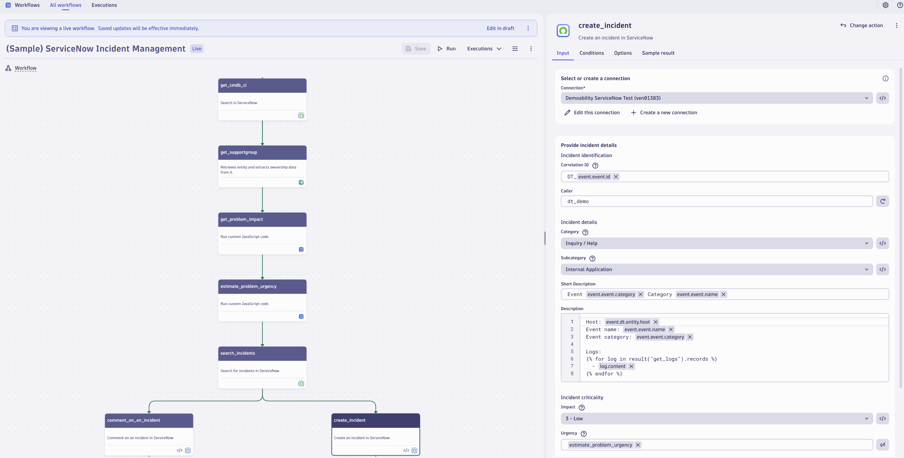

# ServiceNow Incident Management

Create or update one ServiceNow incident per Davis problem, with the right CI, support group, impact and urgency already filled in.

## What it does

This solution contains two workflows:

- **ServiceNow Incident Management** (`servicenow-incident-management.workflow-template.yaml`) runs once Davis has identified a problem's root cause. Its steps:
  1. Adds related logs to the description.
  2. Finds the configuration item in the ServiceNow CMDB.
  3. Gets the support group from Dynatrace ownership.
  4. Calculates impact and urgency.
  5. Creates a new incident or comments on an existing one, so no duplicate tickets are created.
- **ServiceNow Severity from Impact** (`servicenow-severity-from-impact.workflow-template.yaml`) is a shorter example. It calculates the incident severity from the problem's impact, creates the incident and posts a Slack message.

## Screenshots

## Prerequisites

- Dynatrace SaaS with Workflows
- [ServiceNow for Workflows](https://docs.dynatrace.com/docs/platform-modules/automations/workflows/actions/service-now) with a connection
- The ServiceNow **Service Graph Connector for Dynatrace**, which maps Dynatrace entities to CMDB CIs (needed by `get_cmdb_ci`)
- [Ownership](https://docs.dynatrace.com/docs/deliver/ownership) teams assigned to your entities
- For the severity example: [Slack for Workflows](https://docs.dynatrace.com/docs/platform-modules/automations/workflows/actions/slack)
- For the email step: [Email for Workflows](https://docs.dynatrace.com/docs/platform-modules/automations/workflows/actions/email)

## Setup

1. Download the workflow template(s) in this folder.
2. In **Workflows**, choose **Upload** and select the file. The upload guides you through selecting connections.
3. Review the trigger and the tasks described below, then activate the workflow.

How the main workflow works:

- **Trigger:** a Davis problem trigger. A custom filter fires once the root cause is identified and skips problems during maintenance windows. Adjust the entity tags to your needs.
- **`get_cmdb_ci`:** searches the CMDB base class by `correlation_id`.
- **`get_supportgroup`:** finds the owner of the root-cause entity.
- **`get_problem_impact` and `estimate_problem_urgency`:** JavaScript examples of impact and urgency calculations. Change the logic to match your process.
- **`search_incidents`, then `comment_on_an_incident` or `create_incident`:** updates an existing incident or creates a new one.

## Configuration

- **Entity tags in the trigger:** the template filters on a `ServiceNow` tag. Use your own tags.
- **Environment URL:** the `environmentUrl` placeholder (`https://<your-environment-id>.apps.dynatrace.com`) and the `https://xxxx.apps.dynatrace.com` problem links must point to your environment.
- **Incident fields:** caller, category, subcategory and assignment rules in `create_incident`.
- **Severity/urgency logic:** in the JavaScript tasks.

## Notes & limitations

- Migrated from the archived [Dynatrace-workflow-samples](https://github.com/Dynatrace/Dynatrace-workflow-samples) repository.
- More details: [ServiceNow for Workflows documentation](https://docs.dynatrace.com/docs/platform-modules/automations/workflows/actions/service-now).

## Related solutions

- [Jira and Slack Targeted Notifications](../jira-slack-targeted-notifications/)
- [Red Hat Ansible Auto-Remediation](../red-hat-ansible-auto-remediation/): adds automated remediation on top of ServiceNow incidents.
